# Воспроизведение статьи «Super-Convergence: Very Fast Training of Neural Networks Using Large Learning Rates»

*Курс «Эффективные нейронные сети» · ИТМО · Домашнее задание № 2*  
**Источник:** L. N. Smith, N. Topin. *Super-Convergence: Very Fast Training of Neural Networks Using Large Learning Rates*. arXiv:1708.07120v3, 17 мая 2018 г.  
**Цель работы:** проверить ключевые результаты статьи при переносе экспериментальных конфигураций из Caffe в PyTorch, оценить влияние расписания learning rate (LR) и установить пределы воспроизводимости полученных результатов.

## 1. Постановка задачи

В статье Smith и Topin исследуют режим обучения, при котором LR в течение одного цикла увеличивается до необычно высокого значения, после чего снижается. Для ResNet-56 на CIFAR-10 авторы сообщают 92,4% тестовой точности после 10 000 обновлений параметров против 91,2% после 80 000 обновлений при кусочно-постоянном LR (*piecewise constant*, PC). Речь идёт о сопоставлении конкретных конфигураций, а не о гарантированном ускорении любого обучения.

Авторы связывают эффект с регуляризующим действием большого LR. Поэтому при переходе к циклическому расписанию необходимо согласовывать величину LR с weight decay, размером мини-пакета и настройками BatchNorm. В статье также предложена приближённая оценка подходящего LR по последовательным состояниям параметров сети.

В данной работе воспроизводятся следующие части экспериментальной программы:

1. **MNIST / LeNet:** 85 эпох с обратностепенным расписанием LR против 12 эпох с трёхфазным 1cycle; по три независимых начальных состояния, плюс контроль с постоянным momentum.
2. **CIFAR-10 / ResNet-20:** CLR на 20 000 обновлений против PC на 80 000; по три начальных состояния.
3. **CIFAR-10 / ResNet-56:** центральное сравнение CLR на 10 000 обновлений и PC на 80 000; один запуск каждого режима.
4. **Диагностика:** LR range test для LeNet и ResNet-56; секущая оценка LR по формуле (8) статьи.
5. **Контрольные эксперименты:** влияние weight decay, верхней границы LR, обновления статистик BatchNorm и числа обучающих изображений на ResNet-20.

Эксперименты на ImageNet и CIFAR-100, а также проверки Wide-ResNet, DenseNet и других архитектур в объём работы не входят.

## 2. Реализация

### 2.1. Архитектуры и обработка данных

**ResNet-20/56.** В базовом остаточном блоке используются две свёртки с BatchNorm и активацией ReLU между ними; результат второй свёртки складывается с shortcut, затем применяется ReLU. Переход между стадиями уменьшает пространственное разрешение. Shortcut включает average pooling и дополнение числа каналов нулями. Первая свёртка выполняется с `stride=1`: значение `stride=2` в таблице 5 PDF-версии статьи противоречит последующему pooling 8×8; в исходном `Resnet56Cifar.prototxt` указан `stride=1`. По описанию реализации параметры свёрток и схема инициализации MSRA были перенесены из конфигурации Caffe.

**LeNet.** Используются две свёртки с 20 и 50 фильтрами, max pooling и два полносвязных слоя размерностей 500 и 10. ReLU расположен после первого полносвязного слоя. Входные значения MNIST масштабируются множителем 1/256, а инициализация Xavier согласована с принятым в Caffe определением `fan_in`.

**CIFAR-10.** При основном воспроизведении используются значения пикселей 0–255, вычитание среднего изображения обучающей выборки и горизонтальное отражение. Дополнительный вариант предобработки с `RandomCrop(padding=4)` и нормализацией по стандартному отклонению предусмотрен в коде, но не применялся в новых основных сравнениях. Это важно: результаты нельзя автоматически приравнивать к запуску со стандартной `torchvision.Normalize(mean, std)`.

### 2.2. Оптимизатор, BatchNorm и расписания

**SGD.** Основные эксперименты на CIFAR-10 используют momentum 0,9 без Nesterov. Для согласования с исходным Caffe учитывается обновление накопленного momentum при переменном LR:

$$
h_t=\mu h_{t-1}+\eta_t g_t,\qquad
\theta_t=\theta_{t-1}-h_t,
$$

где $g_t$ включает используемый в эксперименте градиент с учётом регуляризации. При переносе на PyTorch выполняется соответствующий пересчёт momentum buffer. Также учтены множитель `lr_mult=2` для смещений свёрточных и полносвязных слоёв и отсутствие weight decay у смещений свёрток. Эти детали существенны: при изменяющемся LR обычная реализация SGD в PyTorch не полностью совпадает с приведённой схемой Caffe.

**BatchNorm.** В Caffe используется коэффициент сохранения накопленных статистик `moving_average_fraction` (MAF). В PyTorch параметр `momentum` задаёт вес нового наблюдения; приближённое соответствие — `momentum = 1 − MAF`. Таким образом, `MAF=0.95` соответствует `momentum=0.05`, а `MAF=0.999` — `momentum=0.001`. Слои с обучаемым аффинным преобразованием выполняют функцию Caffe Scale.

**CLR и 1cycle.** Для CIFAR-10 применяется треугольное расписание: LR линейно меняется от 0,1 до 3,0 и обратно за `2 × stepsize` обновлений. Для MNIST используется трёхфазное 1cycle: подъём LR, возврат к начальному значению и дополнительное уменьшение до $10^{-6}$. Конечное значение $10^{-6}$ выбрано в данной реализации, а не предписано в статье. Для MNIST исследован как противофазный momentum `0.95 → 0.8 → 0.95`, так и постоянный `0.9`. LR устанавливается перед очередным обновлением параметров; журналы содержат фактически использованные значения.

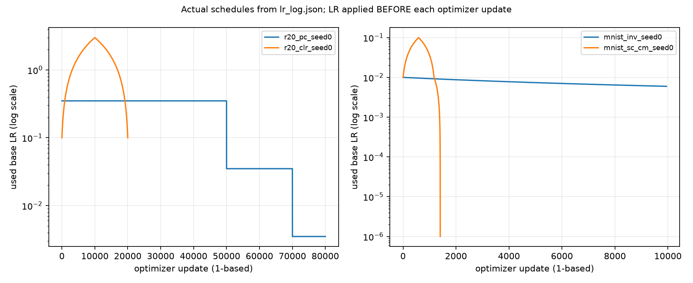

*Рисунок 1. Фактические расписания LR из журналов запусков для CIFAR-10 и MNIST.*

### 2.3. Протокол оценки и вычислительная среда

Критерий сравнения — **точность последнего checkpoint** после заранее заданного числа обновлений параметров, рассчитанная по всем 10 000 тестовым изображениям. Лучшее промежуточное значение accuracy не подменяет итоговую метрику. Тестовая выборка не использовалась для выбора checkpoint, seed или расписания; контрольные абляции выполнялись при фиксированном `seed=0`.

В опытах с несколькими seed использованы значения 0, 1 и 2. В таблицах приведены среднее и выборочное стандартное отклонение (`mean ± std`) по трём запускам. Эти интервалы **не являются доверительными интервалами**.

Основные настройки сведены в таблицу 1.

| Модель / данные | Режим | LR и бюджет | Batch | Momentum | Weight decay | BN MAF |
|:--|:--|:--|--:|:--|--:|--:|
| ResNet-20 / CIFAR-10 | PC | 0.35; ×0.1 на 50k и 70k; 80k шагов | 1000 | 0.9 | 1e-4 | 0.95 |
| ResNet-20 / CIFAR-10 | CLR | 0.1 → 3 → 0.1; 20k шагов | 1000 | 0.9 | 1e-4 | 0.95 |
| ResNet-56 / CIFAR-10 | PC | 0.35; ×0.1 на 50k и 70k; 80k шагов | 1000 | 0.9 | 1e-4 | 0.999 |
| ResNet-56 / CIFAR-10 | CLR | 0.1 → 3 → 0.1; 10k шагов | 1000 | 0.9 | 1e-4 | 0.95 |
| LeNet / MNIST | Inverse | 85 эпох; inverse LR | 512 | 0.9 | 5e-4 | — |
| LeNet / MNIST | 1cycle | 12 эпох; 0.01 → 0.1 → 1e-6 | 512 | 0.95 → 0.8 → 0.95 | 5e-4 | — |

*Таблица 1. Конфигурации основных экспериментов. k означает тысячу обновлений параметров.*

Важное отличие от оригинала: авторы статьи распределяли суммарный batch 1000 между восемью GPU, поэтому BatchNorm вычислялся на локальных частях batch (примерно по 125 изображений). В данной реализации модель работает с полным batch 1000 на одном GPU. Это меняет статистики нормализации. Кроме того, применяются только полные мини-пакеты (`drop_last=True`), а частота промежуточной тестовой оценки отличается от исходных Caffe-конфигураций.

Расчёты выполнялись на двух NVIDIA H100 с независимыми процессами обучения (Python 3.12, PyTorch 2.14.1+cu126). Смешанная точность и autocast не применялись; CIFAR-тензоры хранились в формате `channels_last`. В используемой среде cuDNN TF32 был включён, matmul TF32 — выключен. Время запусков получено на общей машине с параллельной нагрузкой и не служит строгой оценкой аппаратного ускорения.

## 3. Основные результаты

### 3.1. Сводная таблица

| Данные / модель | Режим | Seed, шт. | Обновлений | Финальная accuracy, % | Время, с |
|:--|:--|--:|--:|--:|--:|
| MNIST / LeNet | Inverse | 3 | 9 945 | 99.04 ± 0.01 | 225 |
| MNIST / LeNet | 1cycle, циклический momentum | 3 | 1 404 | 99.15 ± 0.08 | 44 |
| MNIST / LeNet | 1cycle, постоянный momentum | 3 | 1 404 | 99.18 ± 0.07 | 31 |
| CIFAR-10 / ResNet-20 | PC | 3 | 80 000 | 89.35 ± 0.15 | 4 938 |
| CIFAR-10 / ResNet-20 | CLR | 3 | 20 000 | 91.36 ± 0.26 | 1 212 |
| CIFAR-10 / ResNet-56 | PC | 1 | 80 000 | 90.15 | 8 828 |
| CIFAR-10 / ResNet-56 | CLR | 1 | 10 000 | 92.78 | 1 726 |

*Таблица 2. Точность на полном тестовом наборе в конце заданного бюджета. Время включает промежуточные тестовые проверки и приведено справочно.*

### 3.2. MNIST: LeNet

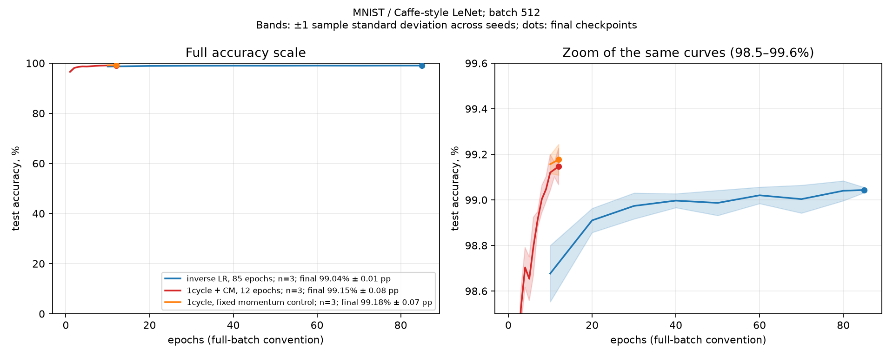

*Рисунок 2. Сравнение inverse policy и 1cycle на MNIST / LeNet по трём seed.*

Обратностепенное расписание (inverse) за 85 эпох дало **99,04 ± 0,01%**, практически совпав с опубликованным результатом **99,03 ± 0,04%**. Трёхфазный 1cycle за 12 эпох достиг **99,15 ± 0,08%** с циклическим momentum и **99,18 ± 0,07%** при постоянном momentum 0,9. В статье для 12 эпох приведено **99,25 ± 0,03%**.

При приблизительно семикратно меньшем количестве обновлений 1cycle обеспечил сопоставимую или немного более высокую точность. Разница с опубликованным результатом 1cycle составляет около 0,1 процентного пункта; её причина отдельно не установлена. В этих опытах отсутствует свидетельство обязательного преимущества циклического momentum: два варианта 1cycle близки по качеству, а число запусков невелико.

### 3.3. CIFAR-10: ResNet-20

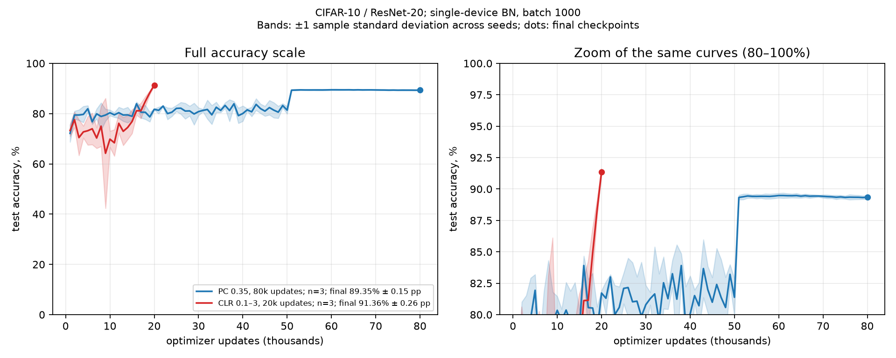

*Рисунок 3. Полные траектории test accuracy и финальные точки на ResNet-20; полосы показывают разброс между seed.*

CLR достиг **91,36 ± 0,26%** за 20 000 обновлений; PC — **89,35 ± 0,15%** за 80 000. Прирост итоговой точности составил **2,01 процентного пункта** при четырёхкратно меньшем бюджете по числу обновлений.

В отличие от сравнения, основанного только на отношении числа шагов, здесь одновременно выполняются два условия: CLR использует меньше обновлений и достигает большей итоговой точности. Поскольку параметры BatchNorm одинаковы в обеих конфигурациях (`MAF=0.95`), данное сравнение лучше изолирует эффект расписания LR, чем центральная пара ResNet-56. Тем не менее изменяются также продолжительность обучения и траектория параметров, поэтому интерпретировать результат как влияние одного мгновенного значения LR нельзя.

### 3.4. CIFAR-10: ResNet-56

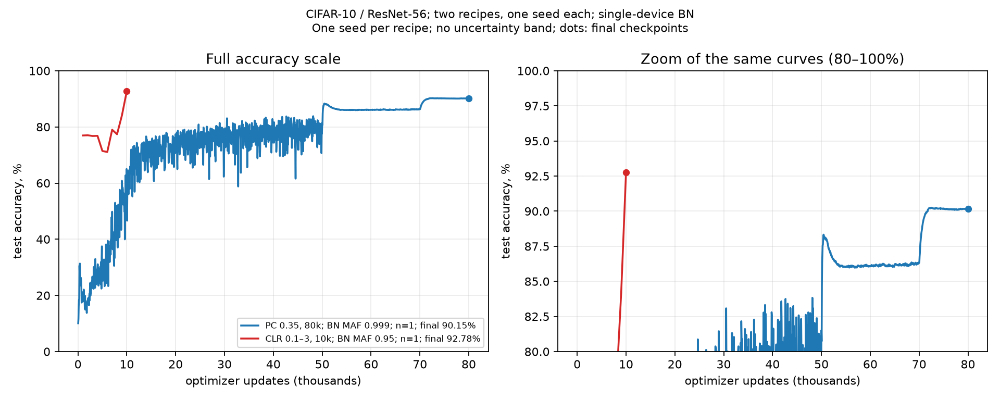

*Рисунок 4. Сравнение CLR и PC на ResNet-56 при seed=0; бюджеты составляют 10 000 и 80 000 обновлений.*

Для центральной пары экспериментов получено **92,78%** после 10 000 обновлений при CLR и **90,15%** после 80 000 при PC: разница **2,63 п.п.** в пользу CLR. В оригинальной статье указаны 92,4% и 91,2% соответственно.

Результат воспроизводит направление основного эффекта статьи, но не её точные показатели. Сравнение проведено только при одном seed. Дополнительно различается скорость накопления статистик BatchNorm (`MAF=0.95` против `0.999`), как и в исходном авторском рецепте. Следовательно, эксперимент сопоставляет **два режима обучения в целом**, а не изолированное действие циклического LR.

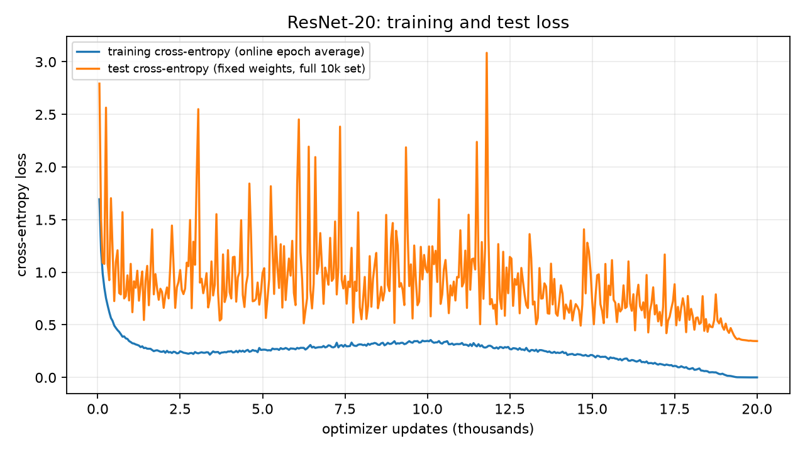

*Рисунок 5. Cross-entropy на train и test для основных расписаний обучения. Train loss усреднён по mini-batches при меняющихся весах; test loss вычислен на полном тестовом наборе при фиксированных весах.*

## 4. Диагностические эксперименты

### 4.1. LR range test

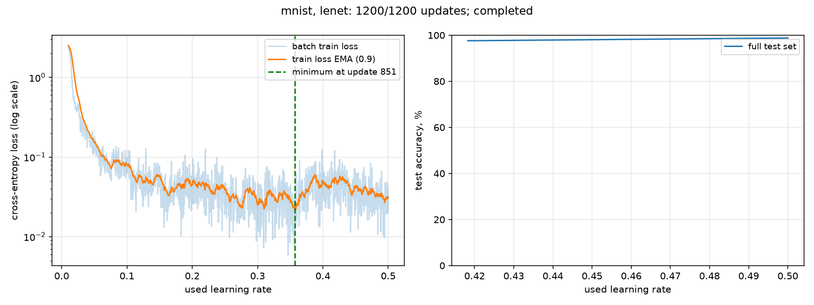

*Рисунок 6. LR range test для LeNet.*

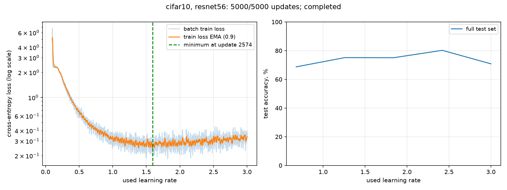

*Рисунок 7. LR range test для ResNet-56.*

Для LeNet выполнено 1 200 обновлений; минимальное значение сглаженного training loss (EMA) достигнуто на шаге 851 при **LR=0,35737**. Для ResNet-56 выполнено 5 000 обновлений; минимум зафиксирован на шаге 2 574 при **LR=1,5926**.

В реализации минимум определяется по **training loss**, а не по максимуму test accuracy, как в исходной диагностике статьи. Поэтому найденные значения следует называть результатами локального критерия, а не авторской верхней границей LR. Для описания начала ухудшения использован порог

$$
L_{\mathrm{thr}}=L_{\min}+0.25\,(L_{\mathrm{start}}-L_{\min}).
$$

Это внутренняя эвристика: порог не равен «росту loss на 25% от минимума» и сам по себе не свидетельствует о численной дивергенции. Нефинитные значения loss в рассматриваемых журналах не зафиксированы.

### 4.2. Секущая оценка LR

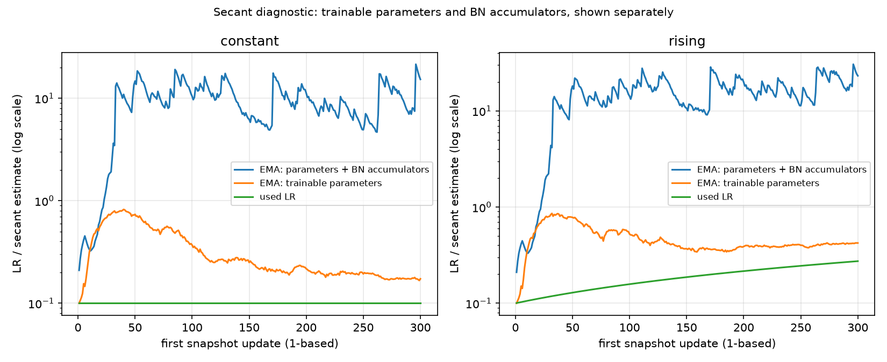

*Рисунок 8. Секущая оценка LR при агрегации только обучаемых параметров и при включении состояний BatchNorm.*

В разделе 4 статьи предложена приближённая оценка LR по трём последовательным состояниям весов. В работе использована глобальная агрегация модулей:

$$
\widehat\eta_t
=\eta_t\,
\frac{\sum_j\left|\theta_{t+1,j}-\theta_{t,j}\right|}
{\sum_j\left|2\theta_{t+1,j}-\theta_{t,j}-\theta_{t+2,j}\right|},
$$

после чего применяется экспоненциальное сглаживание с коэффициентом $\alpha=0.1$. Проверены две области агрегации: только обучаемые параметры и все вещественные массивы параметров/состояний, в том числе накопленные статистики BatchNorm.

| Режим | Конечная EMA: только параметры | Конечная EMA: параметры и BN-состояния | BN MAF |
|:--|--:|--:|--:|
| Постоянный LR 0.1 | 0.173 | 15.297 | 0.999 |
| Растущий LR | 0.423 | 23.166 | 0.999 |

*Таблица 3. Оценка LR в зависимости от включённых состояний модели.*

Диапазон **2–6**, указанный авторами для соответствующего опыта, здесь не получен. Включение накопленных статистик BatchNorm увеличивает оценку в десятки раз. Поскольку эти статистики не обновляются посредством обычного градиентного спуска, интерпретировать такую агрегированную величину как прямую оценку кривизны функции потерь некорректно. Наблюдение характеризует чувствительность предложенной оценки к выбранным переменным; причины расхождения с авторскими числами в отдельном эксперименте не изолированы.

## 5. Контрольные эксперименты

Все опыты этого раздела выполнены на ResNet-20 при `seed=0` и бюджете 20 000 обновлений. Базовый запуск CLR (`max_lr=3`, `weight_decay=1e-4`, `BN MAF=0.95`) дал **91,36%**. Абляции с другим загрузчиком данных сохраняют принцип преобразований, но изменяют порядок mini-batch; их результаты рассматриваются как описательные.

### 5.1. Weight decay, максимум LR и BatchNorm

| Изменяемый параметр | Значение | Финальная accuracy, % | Отличие от baseline, п.п. |
|:--|:--|--:|--:|
| Weight decay | 1e-6 | 88.20 | −3.16 |
| Weight decay | 5e-4 | 81.16 | −10.20 |
| Максимальный LR | 1 | 90.37 | −0.99 |
| Максимальный LR | 6 | 91.36 | 0.00 |
| Вес нового наблюдения BN | 0.001 (MAF 0.999) | 9.03 | −82.33 |

*Таблица 4. Изменение одного параметра относительно основного CLR-запуска. Для LR=6 и BN=0.001 применялся другой порядок mini-batch.*

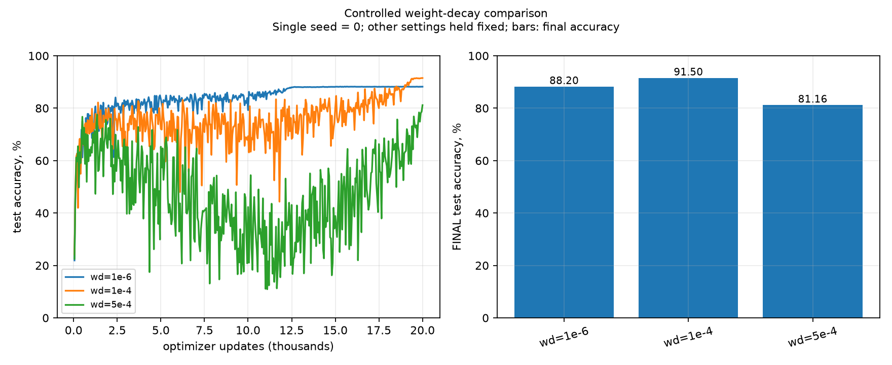

*Рисунок 9. Влияние weight decay на обучение ResNet-20 с CLR.*

**Weight decay.** В проверенном диапазоне лучший результат дал $10^{-4}$: как ослабление до $10^{-6}$, так и усиление до $5\cdot10^{-4}$ снижали итоговую точность. Это согласуется с требованием **балансировать** регуляризацию, а не минимизировать weight decay безусловно.

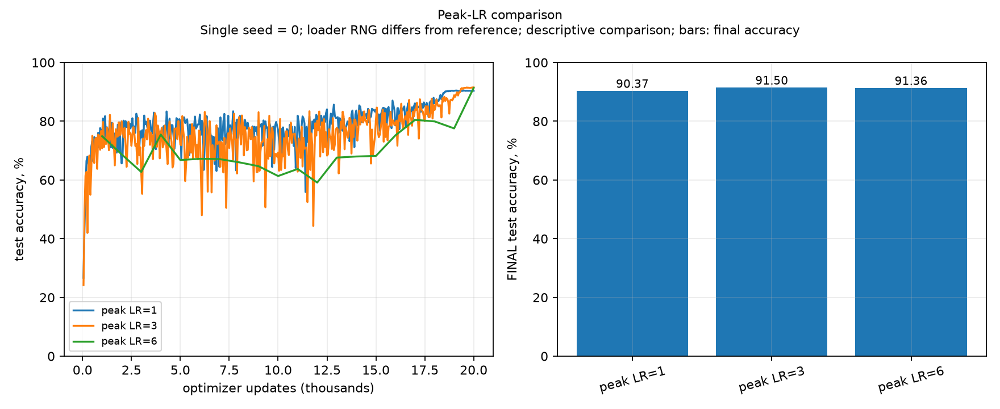

*Рисунок 10. Чувствительность ResNet-20 к верхней границе LR.*

**Максимальный LR.** При `max_lr=1` точность на 0,99 п.п. ниже основного запуска, а при `max_lr=6` совпала с baseline. По одному seed, тем более при различном порядке mini-batch для одной из точек, нельзя сделать вывод об устойчивости метода к выбору верхней границы LR.

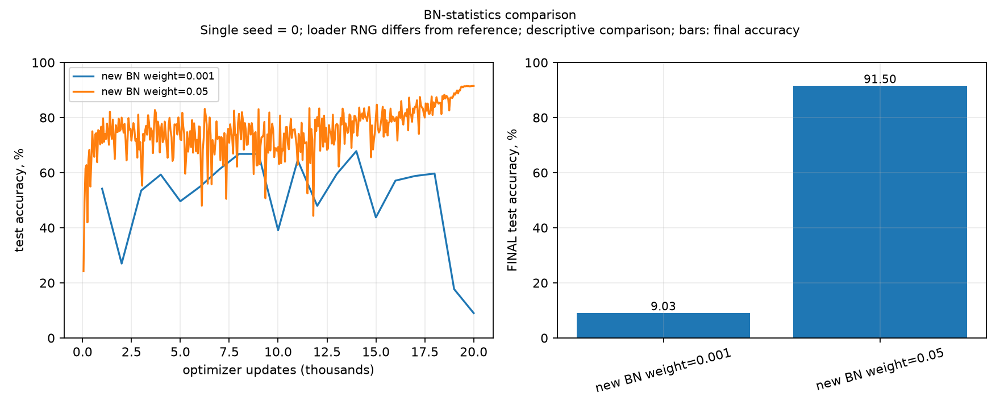

*Рисунок 11. Влияние скорости накопления статистик BatchNorm на обучение ResNet-20.*

**BatchNorm.** При уменьшении веса нового наблюдения до `0.001` финальная тестовая точность составила 9,03% — около уровня случайного угадывания для десяти классов. Это указывает на серьёзную проблему выбранной конфигурации, но не позволяет без дополнительной диагностики разделить неудачную оптимизацию и некорректные накопленные статистики при тестировании. Точность, согласно журналу проверки, была повторно вычислена из сохранённого checkpoint.

### 5.2. Ограниченный объём обучающих данных

Подвыборки из 10 000 и 25 000 изображений сравнивались при одинаковом бюджете **20 000 обновлений** и одинаковой конфигурации внутри каждой пары. Среднее изображение для вычитания рассчитывалось по полным 50 000 обучающим примерам; ограничение применялось к потоку данных SGD.

| Число обучающих изображений | PC accuracy, % | CLR accuracy, % | CLR − PC, п.п. |
|--:|--:|--:|--:|
| 10 000 | 70.91 | 53.01 | −17.90 |
| 25 000 | 85.44 | 88.65 | +3.21 |

*Таблица 5. Подвыборки CIFAR-10, ResNet-20, 20 000 обновлений, один seed.*

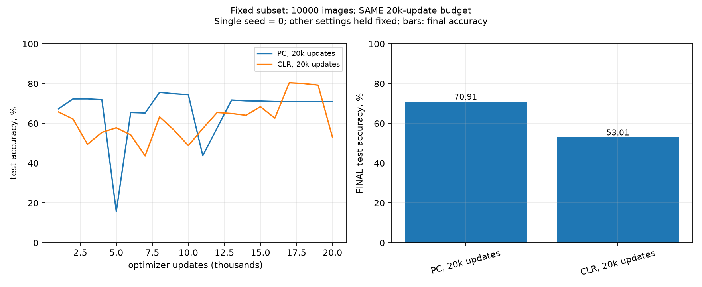

*Рисунок 12. Сравнение PC и CLR на 10 000 обучающих изображений при бюджете 20 000 обновлений.*

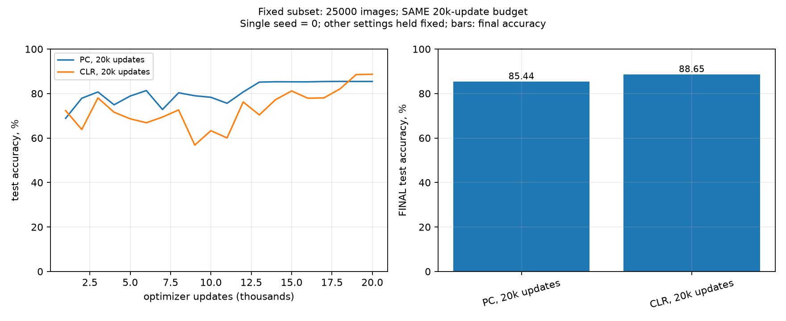

*Рисунок 13. Сравнение PC и CLR на 25 000 обучающих изображений при бюджете 20 000 обновлений. Настройки этих опытов отличаются от таблицы 1 оригинальной статьи.*

На подвыборке из 10 000 изображений преимущество CLR **не подтвердилось**: итоговая точность существенно ниже PC. На подвыборке из 25 000 изображений наблюдается обратная картина. Результаты получены при одном seed и не позволяют подтвердить общий тезис статьи о росте преимущества Super-Convergence при уменьшении числа примеров. Кроме того, в статье для данного анализа используется ResNet-56 и иной бюджет вычислений.

## 6. Воспроизводимость и ограничения

Обучение выполнялось по фиксированным конфигурациям, перечисленным в `code/run_experiments.py` и `runs/manifest.json` (26 обучений и два LR range test). Проверялись структура сети, граничные значения LR-расписаний, порядок применения обновлений и настройки BatchNorm. Завершённые эксперименты сохраняют конфигурацию, журнал изменений LR и momentum, промежуточные оценки и контрольные суммы исходников.

В исходном отчёте указана отдельная проверка сохранённых моделей: загрузка checkpoint, проверка конечности параметров и повторный подсчёт loss и accuracy на полном тестовом наборе. Эти сведения относятся к описанию выполненного протокола; исходные каталоги `runs/` и `figures/` для независимой повторной проверки при подготовке настоящего текста не предоставлялись.

Ограничения интерпретации следующие:

- **Перенос Caffe → PyTorch не побитовый.** Отличаются реализация BatchNorm при распределённом и одиночном batch, порядок данных, вычислительные ядра и режимы обработки входов. Эти эффекты не были изолированы отдельными тестами.
- **Одна конфигурация ≠ один причинный фактор.** Центральная пара ResNet-56 отличается не только расписанием LR, но и BN MAF; результат относится к сравнению авторских рецептов целиком.
- **Число повторов ограничено.** Для MNIST и ResNet-20 имеются три seed; для ResNet-56 и всех абляций — один. На основе единичных запусков нельзя оценить статистическую устойчивость различий.
- **Время запуска не является независимым измерением производительности.** Эксперименты выполнялись на общей вычислительной системе, включая промежуточную оценку качества.
- **Отношение числа обновлений не равно гарантированному ускорению до одинаковой точности.** Такое утверждение требует анализа траекторий accuracy по единому порогу качества и корректного учёта вычислительной стоимости шага.
- **Диагностические оценки ограничены.** LR range test использует локальный критерий EMA loss; секущая оценка существенно зависит от включения статистик BatchNorm.

## 7. Заключение

В PyTorch-адаптации воспроизведено основное направление экспериментального результата Smith и Topin. На ResNet-20 циклическое расписание дало **91,36 ± 0,26%** против **89,35 ± 0,15%** у PC при бюджете 20 000 против 80 000 обновлений; сравнение выполнено по трём seed и при одинаковом BN MAF. На ResNet-56 получено **92,78%** против **90,15%** за 10 000 и 80 000 обновлений соответственно, но только в одном запуске каждой конфигурации. На MNIST вариант 1cycle за 12 эпох обеспечил сопоставимую или более высокую точность, чем inverse policy за 85 эпох.

Контрольные опыты показывают, что качество зависит от совместной настройки LR, weight decay и BatchNorm. Секущая оценка LR не воспроизвела опубликованный численный диапазон и оказалась чувствительна к набору агрегируемых состояний. Эксперименты с ограниченными данными дали смешанный результат: на 10 000 изображений CLR уступил PC, на 25 000 — превзошёл его.

Таким образом, **эффект ускоренного достижения высокого качества подтверждён в основных проверенных конфигурациях, но не носит универсального характера**. Для более строгой репликации необходимы дополнительные seed для ResNet-56, контроль одинаковых статистик BatchNorm и сопоставление качества на одинаковых вычислительных бюджетах. Выводы о динамике LR и балансе регуляризации следует считать результатом исследованных настроек, а не общим правилом для произвольных моделей.

## Приложение. Артефакты и команды

**Команды проверки и запуска:**

```bash
.venv/bin/python code/check_solution.py
bash code/run_all.sh all --gpus 0 1
.venv/bin/python code/verify_report2.py
```

**Файлы проекта:** `code/README.md`, `code/run_experiments.py`, `runs/manifest.json`, `requirements.txt`, `figures/verification.json`, `presentation_super_convergence.pptx`.

**Журналы:** `history.json` — конфигурация, бюджет, версия среды и SHA256 исходников; `lr_log.json` — фактические LR и momentum; `iter_log.json` — промежуточные оценки. У части ранних запусков значение `config.schedule.final_lr` в метаданных представляло неиспользуемый default; использованный LR хранится в `lr_log.json`, разъяснение — в `metadata_notes.json`.

**Исходные графики экспериментов в репозитории:** `figures/mnist.png`, `figures/cifar.png`, `figures/r56.png`, `figures/schedules.png`, `figures/losses.png`, `runs/range_lenet/range_test.png`, `runs/range_resnet56/range_test.png`, `runs/hessian_lr.png`, `figures/wd.png`, `figures/sensitivity.png`, `figures/bn.png`, `figures/limited_10000.png`, `figures/limited_25000.png`. В этом документе используются исходные графики из `report.md`, включая траектории обучения и диагностические эксперименты.

**Библиография**

1. Smith L. N., Topin N. *Super-Convergence: Very Fast Training of Neural Networks Using Large Learning Rates*. arXiv:1708.07120v3, 2018. <https://arxiv.org/abs/1708.07120>.
2. Репозиторий авторов: <https://github.com/lnsmith54/super-convergence>.
